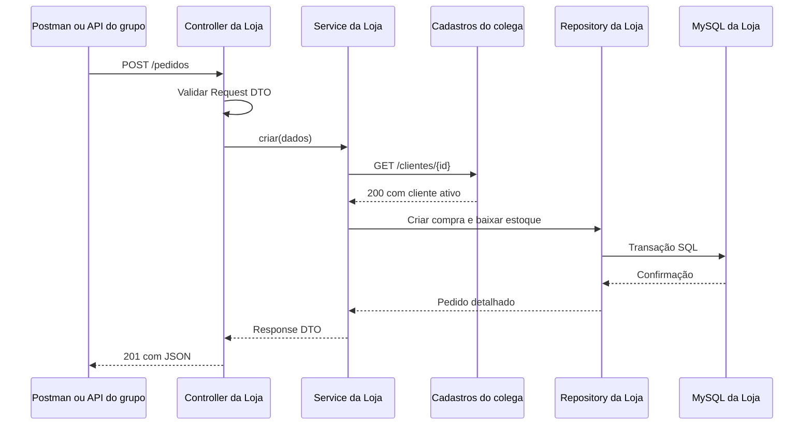

# Loja — adequação à Entrega 2

Referência: PDF fornecido pelo aluno, `DSD - Entrega 2 - 17_09_26.pdf`, páginas 1 e 2.
O documento exige backend em cinco camadas, comunicação síncrona pela rede, repositório remoto e apresentação de 15 minutos. Prazo informado: **08/10/2026 às 18:59**.

## Escopo da sua parte

A Loja mantém produtos, estoque, compras, entrega/retirada e pagamentos administrativos. Cadastros mantém clientes e a Loja consulta esse serviço por HTTP antes de gravar a compra. O terceiro serviço e a API de entrada do grupo devem seguir o diagrama aprovado na Entrega 1, que não foi fornecido nesta revisão. Este projeto contém somente a Loja; não contém a API/Gateway nem os serviços dos colegas.

## Correspondência com os requisitos

| Requisito do PDF                                 | Implementação da Loja                                           | Evidência para mostrar                                                      |
| ------------------------------------------------ | --------------------------------------------------------------- | --------------------------------------------------------------------------- |
| Model: dados e tabelas                           | `src/model/entities.ts`                                         | Entidades das seis tabelas do diagrama do banco                             |
| Repository: interfaces, persistência e consultas | `src/repository/*Repository.ts` e `database.ts`                 | Interfaces de produtos, pedidos e pagamentos; SQL parametrizado e transação |
| Service: orquestração e regras                   | `src/service/ProdutoService.ts`, `PedidoService.ts`, `rules.ts` | Consulta a Cadastros, cálculo em centavos, estoque e transições             |
| Controller: HTTP, validação e status             | `src/controller/*Controller.ts` e `src/app.ts`                  | Validação Zod, JSON, 201/200 e erros 400/404/409/502/503                    |
| DTO: contratos de entrada e saída                | `src/dto/contracts.ts`                                          | Request DTOs e conversão explícita para Response DTOs                       |
| Comunicação síncrona                             | `src/client/CadastrosClient.ts`                                 | `await` no GET de cliente antes de iniciar a transação do pedido            |
| Demonstração no Postman/Insomnia                 | `docs/loja.postman_collection.json` e `examples.http`           | Produto → pedido → pagamento → retirada                                     |
| Link do repositório remoto                       | A providenciar pelo grupo                                       | Código local não comprova envio nem publicação                              |



Se Cadastros rejeitar o cliente ou estiver indisponível, a criação é interrompida antes de acessar o banco. O teste automatizado usa um servidor HTTP local de teste; a apresentação deve usar o serviço real do colega.

## Contrato para combinar com Cadastros

- Método/rota padrão: `GET http://localhost:8082/clientes/{id}`.
- Sucesso: HTTP 200, JSON `{"id":1,"ativo":true}`. `id` é número; `ativo` é opcional e aceita booleano ou 0/1.
- Cliente inexistente: HTTP 404. Cliente inativo: `ativo=false` ou `ativo=0`.
- A Loja retorna 404 para cliente inexistente, 409 para inativo, 502 para erro HTTP/contrato inválido e 503 para conexão indisponível/timeout.
- Configure `CADASTROS_URL` e `CADASTROS_CLIENTE_PATH` no `.env` se o colega usar outra URL/rota. A rota deve conter `{id}`. JSON diferente exige adaptar o contrato no client.
- Na apresentação, use `CADASTROS_MODE=real`. `demo` não comprova a comunicação distribuída.
- Cada serviço mantém seu próprio banco. A Loja não lê diretamente as tabelas de Cadastros e não cria chave estrangeira entre bancos de serviços.

## Banco local

Preencha no `.env` o host, a porta, o usuário, a senha local e o nome real do schema. Não coloque a senha no repositório. O `.env` já está ignorado.

```powershell
cd C:\Users\Lenovo\loja-service\lojapet-service
npm.cmd run db:check
npm.cmd run build
npm.cmd test
npm.cmd run dev
```

`db:check` executa somente consultas: testa autenticação e existência das colunas nas seis tabelas. Não cria schema e não valida todos os tipos, índices ou valores de ENUM. Se só houver um modelo EER no Workbench, crie o schema no servidor usando o SQL aprovado pelo grupo.

Confira no Workbench com `SHOW CREATE TABLE nome_da_tabela`:

- IDs gerados automaticamente; tabelas transacionais (InnoDB).
- `pedidos.status` com padrão `RECEBIDO`, `pedidos.data_criacao` preenchida automaticamente.
- `pagamentos.status` com padrão `PENDENTE`.
- ENUM de modalidade: `ENTREGA`, `RETIRADA`.
- ENUM de pedido: `RECEBIDO`, `EM_PREPARACAO`, `SAIU_PARA_ENTREGA`, `ENTREGUE`, `PRONTO_PARA_RETIRADA`, `RETIRADO`, `CANCELADO`.
- ENUM de pagamento incluindo `PENDENTE`, `APROVADO`, `CANCELADO`; forma incluindo `PIX`, `CARTAO_CREDITO`, `CARTAO_DEBITO`, `DINHEIRO`.
- Campos opcionais de entrega e datas de conclusão aceitando NULL, conforme os Models.

O diagrama enviado não expõe os valores de ENUM nem os defaults; estes pontos precisam ser conferidos no banco real. Não altere tabelas existentes sem revisar o SQL.

## Integração com a API do grupo

Se o diagrama da Entrega 1 possuir uma API/Gateway, o responsável deve encaminhar suas rotas da Loja para este serviço. A convenção já documentada é `/api/loja/*` → `http://localhost:8083/*`, removendo o prefixo. Confirmem essa convenção com o grupo e mostrem também a requisição pela API na apresentação.

Por padrão a Loja escuta em `127.0.0.1`: execute os serviços no mesmo computador para a demonstração local. `localhost` em computadores distintos não aponta para a máquina do colega; nesse cenário será preciso configurar endereço de escuta, rede e URLs entre máquinas.

## Roteiro para os 15 minutos do grupo

Sugestão para a sua parte (cerca de 5 minutos):

1. Mostre as cinco pastas e explique Controller → Service → Repository → banco, com Models e DTOs.
2. Importe `docs/loja.postman_collection.json`. Defina `clienteId` como um cliente real ativo de Cadastros. A coleção salva automaticamente os IDs de produto, pedido e pagamento; execute em ordem. Cada execução cria novos dados.
3. Execute saúde e criação de produto. Crie o pedido de retirada e mostre HTTP 201, total de `240.00` e estoque caindo de 20 para 18.
4. Mostre o log `[HTTP síncrono] Cadastros: cliente ..., status 200` e a rota do colega. Explique que a Loja aguarda a resposta para concluir a operação.
5. Registre/ confirme o pagamento manual e avance o pedido até `RETIRADO`. Confirmação manual não verifica transferência Pix.
6. Para provar falha de integração, desligue Cadastros e tente criar outro pedido: espere 503 e confira que o estoque não mudou. Religue Cadastros em seguida.

Verificações extras antes da apresentação: cliente inexistente → 404; estoque insuficiente → 409; body inválido → 400; pedido não pago não conclui → 409; cancelamento de pedido não pago devolve estoque uma vez. Para entrega use o exemplo de `examples.http`.

## O que ainda exige ação do grupo

- Configurar credenciais do MySQL e executar `db:check` com sucesso.
- Confirmar contrato de Cadastros e rodar a coleção com os serviços reais.
- Confirmar correspondência com o diagrama da Entrega 1 e integrar a API de entrada, se prevista nele.
- Colocar o projeto no repositório remoto do grupo, sem `.env`, `node_modules` ou `dist`; enviar o link conforme o PDF.
- Ensaiar a apresentação conjunta de 15 minutos. Os testes locais não substituem a demonstração conjunta.
